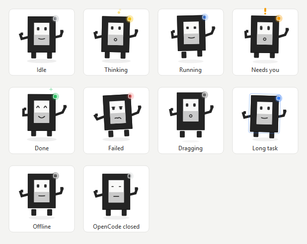

# OpenCode Pet · OpenCode 桌面宠物

**English** · [简体中文](README.zh-CN.md)

**一只住在桌面上的宠物，实时告诉你 OpenCode 正在做什么 —— 不用再切窗口去看。**

`Windows` `Python 3.9+` `PyQt5` `MIT License`

> **OpenCode Pet 是一个独立的、非官方的第三方开源桌宠项目，与 OpenCode 官方团队无隶属关系。**
> "OpenCode" 名称与官方 Logo 归其所有者所有；本项目代码以 MIT 协议发布。



*Ten states, rendered by the real character code from the real state machine:
idle · thinking · running · needs you · done · failed · long task · dragging ·
offline · OpenCode closed. `python tools/gen_preview.py` regenerates this sheet,
so the documentation can never drift from the pet. The same sheet in Chinese is
[`states-zh.png`](docs/images/states-zh.png) - the pet is bilingual and so is
its documentation.*

---

## What it is

The OpenCode desktop app already runs a local HTTP service with a live SSE
event stream. **OpenCode Pet is a read-only observer of that stream.** It never
writes to OpenCode, never mutates a session, never answers a permission
prompt on your behalf.

Submit a prompt, walk away, and the pet tells you when it is thinking, when it
is running a tool (and which one), when **it needs your permission**, and when
it is done.

|  |  |
| --- | --- |
| **Real progress, not a toy** | driven by OpenCode's own event stream, reconciled against `/api/session`, `/api/session/active` and the pending permission lists every 2.5 s. A missed event is repaired, never fatal. |
| **One card per conversation** | title, live state, tool name, step counter and a ticking elapsed time. Running and finished conversations never overwrite each other. |
| **Cards persist until clicked** | a finished task keeps its card - retention is by *acknowledgement*, not by a timer, so nothing disappears quietly while you are away. |
| **Read tasks stay read** | acknowledgement is remembered across restarts, so waking the pet up does not replay every task you have already dismissed. A conversation that runs *again* still shows up. |
| **Permission nudges** | an orange blinking lamp plus a Windows toast when a tool call is waiting on you. |
| **Click to jump** | click the pet to raise OpenCode - or, if its window was closed, start it and wait for the window. Click a card to do that *and* acknowledge that conversation. |
| **Edges are fixtures** | drag past any screen edge and the pet is pinned flush against it, full size and fully visible, then slides along it. |
| **Bilingual end to end** | 中文 / English, switchable in the tray menu at any time, no restart, persisted. |
| **Lives and dies with OpenCode** | a headless sentinel at sign-in starts the pet when OpenCode opens and stops it when OpenCode *and* its background service have both gone. Closing the window alone does not dismiss the pet - it puts the pet to sleep instead, and a click brings OpenCode back. |
| **Never claims what cannot happen** | with the window closed, the pet rests and live cards are withheld: a permission prompt nobody can answer, and a timer for work that cannot progress, are worse than silence. Finished tasks still show. |
| **Self-contained install** | one portable folder plus one `.vbs` in Startup. No registry, no service, nothing injected into OpenCode. |

---

## Install

```bat
:: one double-click: copy, register autostart, start
scripts\Install-Pet.cmd
```

That copies the whole project to `%USERPROFILE%\.config\opencode\pet`, writes
one hidden launcher into the Windows Startup folder, and starts the pet.

**Requirements:** Windows 10/11 and Python 3.9 or newer.

```bat
pip install PyQt5
```

`psutil` is used when present (cheaper process and socket lookups) and is
entirely optional.

Uninstall with `scripts\Uninstall-Pet.cmd`, or:

```bat
python install.py uninstall        :: also removes the folder and the launcher
python install.py uninstall --keep-files
python install.py status
```

### Run it without installing

```bat
scripts\run_pet.cmd                 :: the pet
scripts\run_pet.cmd --demo          :: one synthetic turn, no OpenCode needed
scripts\run_pet.cmd --watch         :: the sign-in sentinel in the foreground
```

---

## The character

The pet is **OpenO / 小 O**: a heavy square **O** - OpenCode's own geometric
mark - given a face, short arms, short feet and a small status lamp.


*An early concept sketch. The shipped version is drawn live with `QPainter`
from the official logo's geometry, not rasterised from this file.*

Two rules keep it readable at 100 px tall:

- **Black, white and grey are permanent.** The body is always `#242424`, the
  face always `#F9F9F8` over `#CACACA`, exactly as in the official mark.
- **Colour is only ever spent on the lamp and the attention marks** - never on
  the body. A running task does not turn the robot blue; the blue *lamp* and a
  rhythmic bounce do that job, so the brand mark stays recognisable in every
  state.

| State | Expression & motion | Lamp |
| --- | --- | --- |
| `idle` | blinking, gentle breathing, glancing left and right | grey |
| `thinking` | gaze lifts, body tilts, three thought dots rise | yellow |
| `executing` | focused narrowed eyes, rhythmic bounce | blue |
| `waiting` | wide eyes with catchlights, `!` bobbing, body raised | orange blink |
| `done` | happy squint arcs, a small hop, sparks | green |
| `error` | drooped eyes, wavy mouth, wobble | red pulse |
| `drag` | feet tucked, body leaning into the cursor, shadow drops | dim |
| `longtask` | slow rocking with a deep blue swell after 10 minutes | blue breath |
| `offline` | level mouth, still posture - the service is unreachable | dim |
| `closed` | shut eyes, level mouth, no marks - OpenCode's window is gone | dim |

Ten states, and the last two exist for a reason: `offline` means the pet cannot
ask OpenCode anything, and `closed` means there is no window in which a human
could answer it. Both are deliberately quiet.

---

## Interface language

**Right-click the pet → 语言 / Language → 中文 or English**

The choice is persisted in `pet_state.json` and changes everything: menus,
badges, cards, relative ages, durations, progress text and notifications. A
fresh install follows the OS UI culture. `--lang zh|en` overrides it.

Every user-facing string lives in one catalogue, `petcore/i18n.py`. Nothing is
hardcoded in the UI, and the test suite asserts that both languages define the
same keys, that every key renders in both, and that no template ever uses a
numbered placeholder (which is how `{tool}` once shipped to the screen
literally).

---

## Architecture

```
OpenCode desktop app (Electron)
    └── opencode-cli.exe serve --service     HTTP API + SSE on 127.0.0.1:<port>
              │  Basic auth: opencode:<password from ~/.config/opencode/service.json>
              │
              │  GET /api/event                    the fast path
              │  GET /api/session                  the slow path
              │  GET /api/session/active
              │  GET /api/session/{id}/permission
              ▼
   petcore/reducer.py     pure, unit-tested, no I/O and no clock
              ▼
   petui/                 openo.py · petwindow.py · cards.py · tray.py
              ▲
   petcore/bridge.py       127.0.0.1:8767 - anything can push work onto the pet
```

Three parts, one direction of data:

1. **`petcore/*.py` - the pure core.** Event folding, reconciliation, the
   priority rule, window geometry, the i18n catalogue. No I/O, no clock, no
   globals: every behaviour worth trusting is a plain function with a test.
2. **`opencode_pet.py` - the wiring.** Two worker threads (stream, poll) feed
   one reducer; a `QObject` bridge marshals their callbacks onto the Qt thread.
3. **`petui/*.py` - the presentation.** Two transparent frameless windows (the
   pet, and a card stack that grows from one card into a full list) plus a
   tray icon. It reads the snapshot and nothing else.

### Why the state comes from the HTTP API, not from files

OpenCode exposes a documented HTTP API with an SSE event stream and a
session-listing endpoint, so the pet uses the supported interface instead of
tailing private storage. Nothing about the service is guessed except the
**port**, which nothing advertises: `petcore/endpoint.py` finds it by asking
the OS which loopback sockets belong to an OpenCode process, then *proves* the
candidate with `GET /api/info`. `python opencode_pet.py --doctor` prints what
it found.

The stream is documented as volatile - events during a disconnection are lost -
so the poll is not a fallback, it is a second half of the design. A pet that
starts mid-session, or that misses ten seconds of events, converges within one
poll cycle instead of lying.

### The privacy boundary

`petcore/reducer.py` reads event payloads only to *recognise* them. What
survives the fold is exactly: a state, tool **names**, step counts, timestamps,
a short machine error code, and the final segment of the working directory as
the project label.

Prompts, model replies, tool arguments, tool results, file contents and
absolute paths are dropped. Session **titles are opt-in** (`--no-titles`, or the
tray menu): they are short, but they are derived from your prompts, so the pet
shows the project folder unless you ask for more.

`tests/run_tests.py` folds an event carrying a secret and asserts the secret is
absent from the resulting facts.

---

## Command line

| Flag | Meaning |
| --- | --- |
| `--lang {zh,en}` | force the interface language |
| `--scale N` | start at this scale (0.5 - 2.0) |
| `--demo` | play one synthetic turn so every state can be seen |
| `--selftest` | regenerate `docs/images/` (both languages) and exit |
| `--doctor` | print resolved paths, the discovered endpoint and the server version |
| `--no-server` | do not open the local HTTP event bridge |
| `--port N` | preferred bridge port (default 8767) |
| `--no-titles` | show the project folder instead of session titles |
| `--always-show` | stay up even when OpenCode is not running |
| `--no-follow` | do not follow the OpenCode lifecycle |

---

## HTTP event bridge

The pet listens on `127.0.0.1:8767` (8767-8776 if taken) so any script can
push work onto it.

```bat
curl -X POST http://127.0.0.1:8767/event ^
  -H "Content-Type: application/json" ^
  -d "{\"state\":\"executing\",\"task\":\"Deploy the release\",\"steps\":12}"
```

Recognised fields: `state` (`idle` / `thinking` / `executing` / `waiting` /
`done` / `error`), `task`, `project`, `steps`, `errors`, `tool`, `session`.

Injected sessions are tagged `external` and never touch OpenCode's data, so
they can never be mistaken for a real conversation. `python tools/demo_events.py`
drives the whole vocabulary through the bridge.

---

## Testing

```bat
python tests\run_tests.py
```

177 unit tests across eleven files cover the event fold, the privacy boundary,
reconciliation, the priority rule, retention and acknowledgement, the i18n
catalogue, the settings store, endpoint discovery, the character renderer
(including the invariant that the body is permanently charcoal and the face
panel stays greyscale in every state), the loopback bridge over a real socket,
the tray menu in both languages, the installer's mirror rules and its
generated VBScript launcher, the sentinel's single-instance lock, and the
promise that no source file hardcodes a path outside its own application root.

```
python tests\run_tests.py
python opencode_pet.py --selftest          # regenerate docs/images (both languages)
python opencode_pet.py --doctor            # is OpenCode reachable?
python tools\live_check.py all             # edge snapping, card flip, focus
```

---

## Repository map

| Path | Role |
| --- | --- |
| `opencode_pet.py` | the wiring: observer threads, reducer, windows, tray, bridge |
| `pet_watcher.py` | the headless sign-in sentinel - imports no Qt, opens no window |
| `install.py` | `install` / `uninstall` / `status` |
| `petcore/reducer.py` | **the pure core** - event fold, reconcile, priority, retention |
| `petcore/endpoint.py` | finding and proving the OpenCode service |
| `petcore/client.py` | HTTP + reconnecting SSE reader, click-to-focus |
| `petcore/i18n.py` | the bilingual catalogue - the single source of truth |
| `petcore/settings.py` | atomic `pet_state.json` persistence |
| `petcore/bridge.py` | the loopback HTTP event bridge |
| `petcore/paths.py` | the whole filesystem layout, relative to the app root |
| `petui/openo.py` | the character - every state is a function of `(state, t)` |
| `petui/petwindow.py` | the frameless window: drag, edge snapping, scale |
| `petui/cards.py` | the session card stack and the expanded list |
| `petui/tray.py` | tray icon and the context menu |
| `tools/gen_preview.py` | regenerate `docs/images/` (one contact sheet per language) |
| `tools/demo_events.py` | drive the pet through the HTTP bridge |
| `tools/live_check.py` | live desktop checks (edges, card flip, focus) |
| `scripts/*.cmd` | double-click helpers |
| `tests/run_tests.py` | the unit tests |
| `assets/brand/` | the official mark and the concept sketches, for identification |
| `assets/icons/` | generated tray and application icons |
| `art/` | design documentation - how the character was drawn. Never installed |
| `docs/images/` | the screenshots both READMEs use |

---

## Contributing

[CONTRIBUTING.md](CONTRIBUTING.md) ·
[CONTRIBUTING.zh-CN.md](CONTRIBUTING.zh-CN.md)

Translations and platform reports are especially welcome. Two rules matter more
than anything else in it: **the project stays dependency-free at runtime** (PyQt5
only, `psutil` optional), and **nothing that can fail may raise inside a Qt
slot**.

---

## Publishing a fork

Step-by-step Git Bash instructions, including the PAT prompt that looks like a
password box but is not one, are in
[docs/UPLOAD-GITHUB.md](docs/UPLOAD-GITHUB.md) ·
[中文](docs/UPLOAD-GITHUB.zh-CN.md).

---

## Maintainer notes (the traps that cost real time)

- **The pet's own state lives inside the app folder.** `paths.APP_ROOT` is the
  directory two levels above `petcore/`, so an installed copy is portable:
  copy the folder, it runs; delete the folder, nothing is left behind. Never
  introduce an absolute path to a development directory.

- **Every i18n placeholder is named.** A template saying `{tool}` with a
  positional argument at the call site renders as the literal string `{tool}`
  on screen. `tests/run_tests.py` fails on any numbered placeholder.

- **The drag clamp must leave `EDGE_SNAP_PX` of slack.** Clamping the window to
  "fully on screen" during a drag means a pet flicked at an edge stops further
  from it than the snap threshold and refuses to stick. `drag_bounds()` allows
  the slack; `clamp_to_screen()` (restore, scaling, resolution change) does not.

- **The contact sheet must translate before drawing each cell.** A card drawn
  at the origin is then overwritten by the next cell's background, and that
  cell silently renders blank. `tests/run_tests.py` asserts every cell has
  ink in it.

- **`scripts/*.cmd` and the `.vbs` launcher are both quoting-hostile.**

  `WScript.Shell.Run` takes **one** command string, and VBScript escapes an
  inner quote as `""`. The command `"<pythonw>" "<script>"` therefore has to be
  written as `"""<pythonw>"" ""<script>"""`. Writing the two paths as adjacent
  literals is a *syntax error*, and `wscript.exe` fails **silently** - the
  sentinel simply never starts at sign-in, with no error anywhere. The file
  must also be CRLF-only. `tests/run_tests.py` checks the generated launcher
  rather than trusting it.

- **Start the pet detached, never from a console you are about to close.** A
  `Start-Process`-ed child stays inside the same Windows job object as the
  shell that spawned it, so it dies when that shell is reaped. That is exactly
  what the sentinel is for: `install.py` writes the `.vbs`, and waking the pet
  the way a sign-in does (`wscript.exe <launcher>`) leaves it fully detached.

- **The sentinel takes a single-instance lock** (`O_CREAT|O_EXCL` on
  `state/sentinel.lock`). Startup can run the launcher more than once, and two
  sentinels would fight over the same pet. A lock left behind by a crashed
  sentinel is reclaimed once its PID is gone.

- **"Is OpenCode running?" means the window *or* the service.** They are
  separate processes with separate lifetimes: `OpenCode.exe` is the Electron app,
  `opencode-cli serve --service` is the background service that owns the session
  store and the API port, and it is **not** a child of the desktop app. Watching
  `desktop_running()` alone made the pet quit the moment the window closed, while
  OpenCode was still alive underneath holding every session - throwing away the
  only way back into a closed app. `endpoint.app_alive()` is the check that
  decides, and both the sentinel and the pet must use it; if they disagree the
  pet exits and is immediately relaunched, which the user sees as flickering.

- **Surviving the window is only half of it: stop believing the service.**
  Because the service outlives the window, it keeps reporting the session exactly
  as it was, so rendering it verbatim means announcing work in progress that
  cannot progress - worst of all a pending permission, i.e. "waiting for your
  authorization" with a ticking timer and a blinking lamp, aimed at someone with
  no window in which to answer it. It also survived a moment after reopening,
  for the same reason: the state on screen was simply stale. `reducer.mood` and
  `reducer.visible` take `app_open`; when it is false the mood is `closed` and
  live cards are withheld, while finished tasks still show because they really
  did finish and are still waiting to be acknowledged.

- **A window reopening is not evidence that anything is running.** This was the
  real cause, and it survived two earlier rounds of fixing. The session records
  in memory are the state as it was *when the app closed*, and the service keeps
  reporting them unchanged, so they still look live. The moment the window came
  back the pet rendered them again: a card saying "waiting for your
  authorization" with its timer **frozen** at the value it had before the close,
  while the API's own `time.idle` was three minutes in the past. Caught by
  photographing the card every 100 ms - the same card, the same frozen "3 m 26 s",
  in every frame from 3 ms to 692 ms after the click. So `invalidate_live()`
  drops the claims when the window closes and only `reconcile`/`apply_event`
  restores them; until then the pet says idle, which is honest.

- **The one claim that demands an action must be confirmed, not assumed.**
  "Waiting for your authorization" is the only thing the pet says that asks
  something of the user, so it is the only one worth being sure about - and it
  is also the one that flickers. When OpenCode starts up, its service briefly
  reports a pending form while the app settles; the pet announced it, blinked
  the lamp, and about a second later, when the form was gone, quietly changed
  its mind. Caught in the pet's own log: `executing -> waiting` and, one second
  later, `waiting -> executing` on every single wake-up.

  A pending form now has to survive `WAIT_CONFIRM_MS` before it becomes the
  reported state. Until then the session is described as what it is actually
  doing - running a tool - which is also true. The same rule applies whether the
  request arrives as a `form.created` event or is found by polling
  `/api/session/{id}/permission`.

  **The confirmation has to be longer than the poll interval, and that is not
  a tuning detail.** `form.created` arrives over SSE the instant it happens, but
  the *absence* of a form can only be noticed by the 2.5 s poll. A confirmation
  shorter than that cannot distinguish a live request from one that was already
  gone - and a first attempt at 1.2 s duly announced every artefact: measured,
  every "waiting" episode on a wake-up lasted ~1.5 s, which was the confirmation
  expiring before the poll could contradict it. At 4 s, five consecutive
  wake-ups produced zero flashes, while a genuine request (which sits for
  minutes) is still announced, just four seconds later.

- **A fact about the world must not be gated on a rendering flag.** Hiding the
  card originally sat *after* `if not snapshot["changed"]: return`. That flag is
  consumed by whichever path reads the snapshot first, so a close could be
  swallowed entirely. Measured at 50 ms on some runs and **1.6 s** on others -
  the tell that it was a race, not the latency. A closed window is handled
  before that early return, unconditionally.

- **A fallback that re-answers the question you just removed is worse than no
  fallback.** `window_ready` briefly fell back to "the process has been up a
  while" to survive a future window-title change. During shutdown the window
  disappears ~1.5 s *before* `OpenCode.exe` does, so the fallback reported
  *open* for that whole 1.5 s and kept the stale card up - the original bug,
  re-introduced through the back door. `window_ready` now uses the process only
  when the window could not be *examined* (`opencode_window_visible` returns
  `None`), which is a different situation from "we looked and it is not there".

- **A correct rule can still be uselessly slow - measure the latency, and log in
  milliseconds.** The chain of fixes for this went 1.7 s → 1.6 s → 80 ms →
  **14 ms**, and every step was found by measurement, not by reading the code.
  The OpenCode window itself disappears ~23 ms after the user clicks close, so
  that is the floor; the pet now adds almost nothing to it. Three things made
  the difference:

  - the liveness check runs on its **own thread at 20 ms**, not on a Qt timer. A
    timer competes with rendering for the event loop and measured a 273 ms tail;
  - the hot path is the `EnumWindows` pass alone (0.6 ms). The 2.2 ms process
    scan is only consulted when the window cannot be examined at all;
  - the **tray icon is only re-rendered when the state changes.** Doing it on
    every refresh was a full render plus a `shell_NotifyIcon` call per SSE
    event, and it starved everything else.

  `log()` writes milliseconds for the same reason: with second-resolution stamps
  the log could not tell a race from a slow poll, and it was the log that
  finally showed the pet hiding the card in 14 ms while the harness claimed 180.

- **Do the routine work off the urgent path.** A busy task emits SSE events
  steadily, and each one rebuilt the cards and re-rendered the pet. That work
  queued *ahead* of the liveness change, so hiding a stale card waited behind
  traffic that was not urgent. Routine refreshes are now coalesced
  (`REFRESH_COALESCE_S`); the timer and the liveness watcher both pass
  `urgent=True` and never wait. Below ~120 ms a human cannot see the difference
  anyway.

- **A WinEvent hook is the obvious answer here, and it is the wrong one.** It
  crash-looped the pet. Calling a ctypes callback that re-enters Python from
  inside the Win32 message pump corrupts the stack, and the crash log points at
  `app.exec_()` - which tells you nothing about the cause. Polling a cheap
  predicate on a background thread is not glamorous and it works.

- **Look at the pixels, not just at your own instrumentation.** Every numeric
  check said the card was gone in 50 ms, while a screenshot taken every 100 ms
  showed it still there for 1.6 s. Two traps hid the truth: `tasklist` gives no
  command line for `pythonw.exe`, so filtering processes by script name silently
  matched nothing and the harness was measuring a different pet than it thought;
  and `PrintWindow` on a capture loop costs more than the 100 ms it claims to
  sample at. When a number refuses to match what a user sees, the number is the
  thing that is wrong.

- **"Has this been read?" needs a stamp that survives a restart.**
  `record["finished"]` is the *local* clock at the moment this pet noticed the
  task end, so it is a different number on every start and can never be compared
  against a value remembered from a previous run. The server's `time.idle` is
  the one stamp that is identical before and after a restart, so it is kept
  separately as `record["server_finished"]` and used as the comparison key
  (`reducer.ack_key`). Also note the API reports a **stale `time.idle` from the
  previous run** of a session that is live now, so it has to be cleared when
  `reconcile` adopts the running truth - otherwise work in progress carries a
  completion stamp and the read-memory matches it.

- **The pet takes a single-instance lock (`state/pet.lock`).** Two copies share
  the two frameless windows, the tray icon and the event-bridge port, so the
  second one is not a degraded mode - it is a second character fighting for
  the same corner, and the loser of the port race just looks hung. The
  sentinel uses a *different* lock (`sentinel.lock`); sharing one would mean
  the sentinel's own claim blocks the pet it just launched.

- **A crash inside a Qt slot kills the whole event loop.** That is why several
  of the bugs above looked like "the pet restarted" rather than as errors:
  `persist_pos` passed `save_pos=False` to a method whose parameter is `save`,
  and a `TypeError` (or a `NameError` for an import its caller owned) raised
  out of a signal handler took the process with it. The sentinel then dutifully
  relaunched it, so the log showed a clean new start and no error at all. **Any
  exception reaching a Qt slot is fatal here** - wrap anything that can fail.

- **An argument-dropping wrapper is just as fatal.** `once_per_click` was typed
  `Callable[[], None]` and called `slot()`, so the card click - which passes a
  session id - raised `TypeError` on every click. A guard must forward `*args`.

- **Match window titles narrowly, and skip your own process.** A bare
  `"opencode" in title` also matches the pet's own windows, titled "OpenCode
  Pet" and "OpenCode Pet cards", so clicking the pet raised the pet. Use the
  scored matcher plus a PID filter.

- **A score of 0 means "no", so the running best must start at 0 — not `-1`.**
  The comparison was `points > best["score"]` with `best` initialised to `-1`,
  while `window_title_score` returns `0` for "definitely not OpenCode". A zero
  therefore beat the initial value: **with the OpenCode window closed** - the
  exact situation this pet exists for - the pet raised whatever unrelated window
  happened to be enumerated first (another desktop pet, on the machine this was
  found on) and reported success, so the launch step never ran and the click did
  nothing at all. Initialise at `0`, and treat "no candidate" as a failure so
  the caller knows to try starting the app.

- **Reject the pet's own titles in the matcher, not only by PID.** They scored
  70 and were kept out only by the caller excluding its own PID, which makes
  correctness depend on the lookup happening to run inside the pet's process.
  Any other caller — a helper script, a test, a future tool — would happily
  raise another desktop pet.

- **`AttachThreadInput` is exported by user32, not kernel32.** `kernel32` has no
  such symbol, so the foreground-retry path raised `AttributeError` every single
  time Windows refused the first foreground change — that is, exactly and only
  when the retry was needed. From a click that meant a dead button; from a Qt
  slot it would also have killed the event loop. Two more traps in the same
  neighbourhood: `dir()` on a ctypes `WinDLL` lists only attributes already
  accessed, **not** the module's exports (so it cannot be used to check whether
  a function exists), and `GetProcAddress` must be used to ask the OS properly.

- **Separate "is there a window?" from "start the app", and never claim success
  from a spawn.** `focus_desktop()` with no argument *already* launched the
  executable, so the old code's second "fallback" call was byte-for-byte the
  same call as the first: when it failed, the failure was repeated and the user
  got nothing. And `Popen` returning only means a process was created — a cold
  Electron start takes a second or two to map its window, so "launched" is not
  "the user can see it". `launch_desktop_and_wait()` waits for a real window and
  raises it.

- **Never block the Qt thread waiting for another program to start.** That wait
  runs in a slot, and a blocking multi-second wait there freezes the whole pet:
  no repaint, no dragging. The slow half runs on a worker thread and reports
  back over a Qt signal, so the toast still happens on the UI thread.

- **`install.py` must match a pet by its working directory too.** A pet started
  from the install directory has the bare argv `opencode_pet.py` and *no
  directory in its command line*, so a path-only match missed it and every
  reinstall left an orphan on the desktop.

- **Reinstall must clear the lock files.** A lock naming a process that no
  longer exists would otherwise keep the next pet from ever claiming it.

- **Centre a wide card on the pet; never edge-align it.** The card is 268 px
  wide against the pet's 132, so matching their right edges left 136 px hanging
  out on the left and none on the right - the card looked like it sat at the
  pet's *upper left*. Centring makes the overhang symmetric, which is what
  "directly above" actually looks like. Against a screen edge centring cannot
  fit and the clamp wins; the card then sits flush with that edge, which is
  the sensible reading there.

- **Keep the card's width fixed.** An adaptive width - shrinking the card so it
  could always centre - was implemented and then reverted: it made the card
  visibly change size as the pet moved, which read worse than the edge
  asymmetry it was meant to remove. Don't reintroduce it.

- **Show a widget before trusting its geometry, then move it again.** Qt has no
  real geometry for a widget that has never been shown, so a first placement
  lands on a default rect. Placing, then showing, then placing again is the
  fix; the earlier version placed only, and the stack stayed invisible while
  the log cheerfully reported cards on screen.

- **A `QSystemTrayIcon` must have its icon before it is shown**, or Windows logs
  `setVisible: No Icon set`.

- **Build tray actions through the menu, not with `QAction(text, parent)`.** In
  PyQt5 the two-argument form does not reliably keep the text, so the menu ends
  up with unnamed, unclickable entries.

- **`Qt.SquareJoin` does not exist in PyQt5.** Use `Qt.MiterJoin`.

- **`setFixedSize` takes two ints, not a tuple.**

- **PyQt5 crashes at interpreter exit** if a `QApplication` is torn down after
  its children. Keep a module-level reference and shut it down explicitly
  (`tests/run_tests.py` does).

- **Card windows are shown, never activated.** On Windows a window shown without
  activation must still be hit-tested by the mouse, which Qt handles, but
  raising it on every refresh steals focus from whatever you are typing in.

---

## Licence

MIT - see [LICENSE](LICENSE), including the trademark notice.

OpenCode's own code is open source; that licence is not a blanket licence to
its brand assets. The character "OpenO" is an original interpretation created
for this project and is used for personal, non-commercial desktop-pet purposes.
