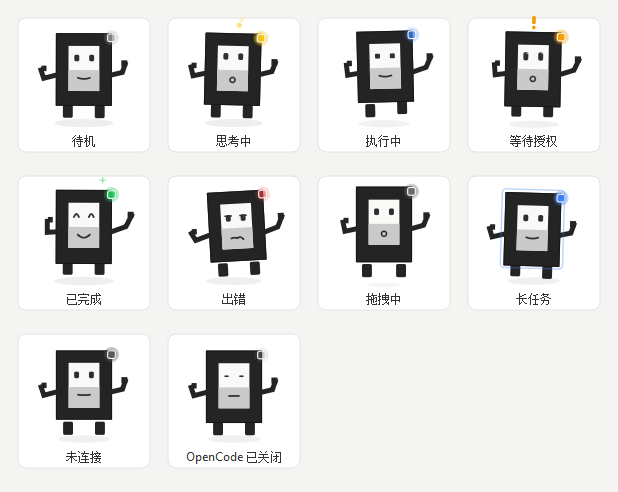

# OpenCode Pet · OpenCode 桌面宠物

[English](README.md) · **简体中文**

**一只住在桌面上的宠物，实时告诉你 OpenCode 正在做什么 —— 不用再切窗口去看。**

`Windows` `Python 3.9+` `PyQt5` `MIT License`

> **OpenCode Pet 是一个独立的、非官方的第三方开源桌宠项目，与 OpenCode 官方团队无隶属关系。**
> "OpenCode" 名称与官方 Logo 归其所有者所有；本项目代码以 MIT 协议发布。



*十种状态，全部由真实角色代码 + 真实状态机实时绘制：待机 · 思考中 · 执行中 ·
等待授权 · 已完成 · 出错 · 长任务 · 拖拽中 · 离线 · OpenCode 已关闭。
执行 `python tools/gen_preview.py` 即可重新生成这张图，因此文档永远不会和桌宠脱节。
同一张图的英文版是 [`states-en.png`](docs/images/states-en.png) —— 桌宠是双语的，文档也是。*

---

## 这是什么

OpenCode 桌面版本身就带有一个本地 HTTP 服务和一条实时的 SSE 事件流。
**OpenCode Pet 只是这条事件流的只读观察者。** 它从不写入 OpenCode，从不修改
会话，也绝不会替你回答权限请求。

你提交任务然后走开，桌宠会告诉你它什么时候在思考、什么时候在调用工具（以及
是哪个工具）、什么时候**需要你授权**、什么时候完成。

|  |  |
| --- | --- |
| **真实进度，不是玩具** | 由 OpenCode 自己的事件流驱动，并每 2.5 秒与 `/api/session`、`/api/session/active` 和待处理权限列表对账。漏掉的事件会被修复，而不会致命。 |
| **每个会话一张卡片** | 标题、实时状态、工具名、步数、不断跳动的耗时。运行中的会话和已完成的会话永远不会互相覆盖。 |
| **卡片一直保留到被点击** | 已完成的任务保留卡片 —— 保留策略是"确认"而不是"计时"，所以你离开期间不会有任何东西悄悄消失。 |
| **看过的不再重放** | "已读"状态会跨重启记住，所以桌宠再次唤醒时不会把已经确认掉的任务再弹一遍；同一个对话**重新开工**时仍然会照常提示。 |
| **权限提醒** | 需要授权时指示灯橙色闪烁，并弹出 Windows 系统通知。 |
| **点击跳转** | 点击桌宠把 OpenCode 窗口带到前台；点击卡片则是"带到前台 **并且** 确认该会话"。 |
| **边缘是停靠位，不是藏身处** | 拖到任意屏幕边缘，桌宠会完整地贴边吸附，然后沿着这条边滑动 —— 这是刻意的反面：宠物不会把自己藏起来。 |
| **完全双语** | 中文 / English，随时在托盘菜单切换，无需重启，选择会被记住。 |
| **随 OpenCode 生灭** | 一个无窗口的哨兵在登录时启动：OpenCode 打开就拉起桌宠，**OpenCode 窗口和它的后台服务都结束**才带走桌宠。只关窗口不赶桌宠走 —— 这时桌宠会进入睡眠，点一下就能把 OpenCode 唤回来。 |
| **不谎报做不到的事** | 窗口关着的时候桌宠只是安静休息，运行中的卡片也会收起来：一个没人能回答的授权请求、一个为无法推进的活儿走的计时器，都比沉默更糟。已完成的卡片照常显示。 |
| **自包含安装** | 一个便携目录 + 启动文件夹里的一个 `.vbs`。不写注册表，不装服务，不往 OpenCode 里注入任何东西。 |

---

## 安装

```bat
:: 双击即可：复制文件、注册开机自启、立即启动
scripts\Install-Pet.cmd
```

它会把整个项目复制到 `%USERPROFILE%\.config\opencode\pet`，在 Windows 启动
文件夹里写入一个隐藏的启动器，然后启动桌宠。

**环境要求：** Windows 10/11 与 Python 3.9 及以上。

```bat
pip install PyQt5
```

`psutil` 存在时会使用（进程与套接字查询更快），但**完全可选**。

卸载：`scripts\Uninstall-Pet.cmd`，或者：

```bat
python install.py uninstall        :: 同时删除安装目录与启动器
python install.py uninstall --keep-files
python install.py status
```

### 不安装直接运行

```bat
scripts\run_pet.cmd                 :: 桌宠
scripts\run_pet.cmd --demo          :: 播放一遍合成任务，不需要开 OpenCode
scripts\run_pet.cmd --watch         :: 前台运行登录哨兵
```

---

## 角色形象

桌宠是 **OpenO / 小 O**：OpenCode 官方几何「O」标志被拟人化 —— 粗方形外框
（也就是 O 本身），加上一张脸、短短的手臂、短短的脚，和一颗小小的状态灯。


*早期概念草图。正式版本是用 `QPainter` 依据官方 Logo 的几何实时绘制出来的，
并不是把这张图位图化。*

两条规则让角色在 100 像素高时依然清晰：

- **黑白灰是永久特征。** 机身永远是 `#242424`，面板永远是从 `#F9F9F8` 到
  `#CACACA` 的上下两段，与官方标志完全一致。
- **颜色只花在状态灯和提示符号上** —— 永远不会落在机身上。执行任务时不需要
  让整个机器人变蓝，蓝色**指示灯**加上有节奏的弹动就足够表达；这样官方标志在
  任何状态下都保持可辨识。

| 状态 | 表情与动作 | 指示灯 |
| --- | --- | --- |
| `idle` 待机 | 眨眼、轻微呼吸、左右张望 | 灰色 |
| `thinking` 思考 | 目光上移、身体微斜、三颗思考小点升起 | 黄色 |
| `executing` 执行 | 眼神专注、机身有节奏地弹动 | 蓝色 |
| `waiting` 等待授权 | 睁大眼带高光、`!` 上下浮动、机身抬高 | 橙色闪烁 |
| `done` 完成 | 弯眼笑、轻轻一跳、迸出火花 | 绿色 |
| `error` 出错 | 眼睛下垂、嘴巴波浪、左右摇晃 | 红色脉冲 |
| `drag` 拖拽 | 双脚收起、机身朝拖拽方向倾斜、影子变小 | 变暗 |
| `longtask` 长任务 | 缓慢摇晃；超过 10 分钟后指示灯缓慢深呼吸 | 蓝色呼吸 |
| `offline` 离线 | 嘴巴平直、姿态静止 —— 服务连不上 | 变暗 |
| `closed` 已关闭 | 闭眼、嘴巴平直、没有提示符 —— OpenCode 窗口没了 | 变暗 |

十种状态，最后两种的存在是有理由的：`offline` 表示桌宠根本问不到 OpenCode，
而 `closed` 表示连一个能让人回答的窗口都没有。两种状态都刻意保持安静。

---

## 界面语言

**右键桌宠 → 语言 / Language → 中文 或 English**

选择保存在 `pet_state.json`，并且会改变**所有**内容：菜单、徽标、卡片、相对
时间（"刚刚 / 3 分钟前" ↔ "just now / 3 min ago"）、耗时、进度文案和通知。
全新安装会跟随系统界面语言，`--lang zh|en` 可以覆盖。

所有面向用户的字符串都集中在 `petcore/i18n.py` 一张表里，界面代码里没有任何
硬编码文本。测试套件会断言：两种语言键集合完全一致、每个键在两种语言下都能
渲染、并且**任何模板都不允许使用带序号的占位符**（曾经有一次 `{tool}` 就是
这样原样显示在屏幕上的）。

---

## 架构

```
OpenCode 桌面版（Electron）
    └── opencode-cli.exe serve --service     HTTP API + SSE，监听 127.0.0.1:<随机端口>
              │  Basic 认证：opencode:<~/.config/opencode/service.json 里的密码>
              │
              │  GET /api/event                    快路径
              │  GET /api/session                  慢路径
              │  GET /api/session/active
              │  GET /api/session/{id}/permission
              ▼
   petcore/reducer.py     纯函数、单元测试，不做 I/O、不读时钟
              ▼
   petui/                 openo.py · petwindow.py · cards.py · tray.py
              ▲
   petcore/bridge.py       127.0.0.1:8767 —— 任何脚本都能往桌宠推任务
```

三部分，数据只朝一个方向流动：

1. **`petcore/*.py` —— 纯核心。** 事件折叠、对账、优先级规则、窗口几何、
   i18n 词表。没有 I/O、没有时钟、没有全局状态：所有值得信赖的行为都是一个
   带测试的纯函数。
2. **`opencode_pet.py` —— 接线层。** 两个工作线程（事件流、轮询）喂给同一个
   reducer；一个 `QObject` 桥把它们的回调切换到 Qt 线程上执行。
3. **`petui/*.py` —— 表现层。** 两个透明无边框窗口（桌宠本身，以及一张卡片
   卡片能展开成完整列表的卡片栈）加一个托盘图标。它只渲染快照，别的什么都不做。

### 为什么状态来自 HTTP API，而不是直接读文件

OpenCode 提供了带 SSE 事件流和会话列表接口的正式 HTTP API，所以桌宠直接使用
被官方支持的接口，而不是去跟踪私有存储。除了**端口**之外没有任何东西需要猜：
`petcore/endpoint.py` 的做法是让操作系统列出属于 OpenCode 进程的本地监听
套接字，再用 `GET /api/info` **证明**这个候选是对的。
`python opencode_pet.py --doctor` 会打印它找到的结果。

事件流在文档里被明确说明是易失的 —— 断线期间的事件会丢失 —— 所以轮询不是
"降级方案"，而是设计的另一半。一个从任务中途才启动的桌宠，或者错过了十秒
事件的桌宠，会在一个轮询周期内收敛，而不是撒谎。

### 隐私边界

`petcore/reducer.py` 读取事件负载只是为了**识别**它们。折叠之后保留的只有：
状态、工具**名称**、步数、时间戳、一段简短的机器错误码，以及工作目录的最后
一段（作为项目标签）。

提示词、模型回复、工具参数、工具结果、文件内容和绝对路径全部丢弃。
会话**标题是可选的**（`--no-titles`，或托盘菜单开关）：标题很短，但它来自你
的提示词，所以默认显示项目文件夹名，除非你明确要求更多。

`tests/run_tests.py` 会折叠一条携带密钥的事件，并断言密钥不会出现在最终事实里。

---

## 命令行

| 参数 | 含义 |
| --- | --- |
| `--lang {zh,en}` | 强制界面语言 |
| `--scale N` | 以该缩放启动（0.5 - 2.0） |
| `--demo` | 播放一遍合成任务，可以看到全部状态 |
| `--selftest` | 重新生成 `docs/images/`（中英双语）然后退出 |
| `--doctor` | 打印解析出的路径、发现的端口和服务器版本 |
| `--no-server` | 不开启本地 HTTP 事件桥 |
| `--port N` | 指定事件桥端口（默认 8767） |
| `--no-titles` | 用项目目录名代替会话标题 |
| `--always-show` | 即使 OpenCode 没开也保持显示 |
| `--no-follow` | 不跟随 OpenCode 的生命周期 |

---

## HTTP 事件桥

桌宠监听 `127.0.0.1:8767`（被占用则顺延到 8767-8776），任何脚本都能往上推任务。

```bat
curl -X POST http://127.0.0.1:8767/event ^
  -H "Content-Type: application/json" ^
  -d "{\"state\":\"executing\",\"task\":\"发布版本\",\"steps\":12}"
```

可识别字段：`state`（`idle` / `thinking` / `executing` / `waiting` / `done` /
`error`）、`task`、`project`、`steps`、`errors`、`tool`、`session`。

注入的会话被标记为 `external`，绝不触碰 OpenCode 的数据，因此不可能和真实
会话混淆。`python tools/demo_events.py` 可以把整套状态词表通过事件桥跑一遍。

---

## 测试

```bat
python tests\run_tests.py
```

177 个单元测试、11 个文件，覆盖事件折叠、隐私边界、对账、优先级规则、保留与
确认策略、i18n 词表、设置存储、端口发现、角色渲染（其中包括"机身永远是深炭
黑、面板在任何状态下都是灰度"这两条不变量的断言）、真实套接字上的本地事件桥、
双语托盘菜单、安装器的镜像规则与它生成的 VBScript 启动器、哨兵的单实例锁，
以及"任何源文件都不得硬编码自身应用根目录之外的路径"这条承诺。

```bat
python tests\run_tests.py
python opencode_pet.py --selftest          # 重新生成 docs/images（中英双语）
python opencode_pet.py --doctor            # OpenCode 连得上吗？
python tools\live_check.py all             # 边缘吸附、卡片翻转、前台聚焦
```

---

## 目录结构

| 路径 | 职责 |
| --- | --- |
| `opencode_pet.py` | 接线层：观察线程、reducer、窗口、托盘、事件桥 |
| `pet_watcher.py` | 无窗口登录哨兵 —— 不 import Qt，不开窗口 |
| `install.py` | `install` / `uninstall` / `status` |
| `petcore/reducer.py` | **纯核心** —— 事件折叠、对账、优先级、保留策略 |
| `petcore/endpoint.py` | 定位并验证 OpenCode 服务 |
| `petcore/client.py` | HTTP + 可重连的 SSE 读取、点击聚焦 |
| `petcore/i18n.py` | 双语词表 —— 唯一的文案来源 |
| `petcore/settings.py` | 原子写入的 `pet_state.json` |
| `petcore/bridge.py` | 本地 HTTP 事件桥 |
| `petcore/paths.py` | 全部文件系统布局，一律相对应用根目录 |
| `petui/openo.py` | 角色渲染 —— 每个状态都是 `(state, t)` 的函数 |
| `petui/petwindow.py` | 无边框窗口：拖拽、边缘吸附、缩放 |
| `petui/cards.py` | 会话卡片栈与展开列表 |
| `petui/tray.py` | 托盘图标与右键菜单 |
| `tools/gen_preview.py` | 重新生成 `docs/images/`（每种语言一张总览图） |
| `tools/demo_events.py` | 通过事件桥驱动桌宠 |
| `tools/live_check.py` | 实机检查（边缘、卡片翻转、聚焦） |
| `scripts/*.cmd` | 双击即用的脚本 |
| `tests/run_tests.py` | 单元测试 |
| `assets/brand/` | 官方标志与概念草图，仅用于标识 |
| `assets/icons/` | 生成的托盘与应用图标 |
| `art/` | 设计文档 —— 角色是怎么画出来的。安装时永不携带 |
| `docs/images/` | 两份 README 共用的截图 |

---

## 参与开发

[CONTRIBUTING.md](CONTRIBUTING.md) ·
[CONTRIBUTING.zh-CN.md](CONTRIBUTING.zh-CN.md)

欢迎提交翻译和平台相关的问题。里面最重要的两条规则是：**运行时必须零依赖**
（只依赖 PyQt5，`psutil` 可选），以及**任何可能失败的东西都不能在 Qt 槽里抛异常**。

---

## 发布到 GitHub

逐步的 Git Bash 操作指令（包括那个"看起来像密码框、其实不是"的令牌提示）见
[docs/UPLOAD-GITHUB.md](docs/UPLOAD-GITHUB.md) ·
[中文](docs/UPLOAD-GITHUB.zh-CN.md)。

---

## 维护者笔记（那些真正花过时间的坑）

- **桌宠的所有状态都放在应用目录内部。** `paths.APP_ROOT` 是 `petcore/` 上面
  两层的目录，所以安装后的副本是可移植的：复制整个目录就能运行，删除目录就
  什么都不剩。**永远不要引入指向开发目录的绝对路径。**

- **i18n 的每一个占位符都是具名的。** 模板写 `{tool}` 而调用处传了位置参数，
  结果就是屏幕上原样显示 `{tool}`。`tests/run_tests.py` 会对任何带序号的占位符
  直接判失败。

- **拖拽时的边界钳制必须留出 `EDGE_SNAP_PX` 的余量。** 如果拖拽时把窗口钳制
  成"完全在屏幕内"，那么被甩向边缘的桌宠会停在离边缘比吸附阈值更远的地方，
  于是死活贴不上。`drag_bounds()` 留余量，`clamp_to_screen()`（恢复位置、缩放、
  分辨率变化时）不留。

- **状态总览图必须先 `translate` 再画每个格子。** 画在原点的卡片背景会被下一个
  格子的背景覆盖，那个格子就会静悄悄地变成空白。
  `tests/run_tests.py` 会断言每个格子里都有墨迹。

- **`scripts/*.cmd` 和 `.vbs` 启动器都对引号极其敏感。**

  `WScript.Shell.Run` 只接受**一个**命令字符串，而 VBScript 用 `""` 转义内部
  引号。所以命令 `"<pythonw>" "<script>"` 必须写成 `"""<pythonw>"" ""<script>"""`。
  把两个路径写成相邻字面量是**语法错误**，而 `wscript.exe` 会**静默失败** ——
  哨兵在开机时压根不会启动，而且任何地方都看不到报错。文件还必须只用 CRLF。
  `tests/run_tests.py` 会校验生成的启动器，而不是相信它。

- **一定要以脱离的方式启动桌宠，绝不要从一个马上就要关闭的控制台启动。**
  `Start-Process` 起的子进程仍然留在启动它的 shell 的同一个 Windows 作业对象
  里，因此那个 shell 被回收时桌宠会一起死掉。哨兵正是为此存在的：`install.py`
  负责写 `.vbs`，而用和开机一样的方式唤醒
  （`wscript.exe <launcher>`）会让桌宠彻底脱离。

- **哨兵会取单实例锁**（`state/sentinel.lock` 上的 `O_CREAT|O_EXCL`）。开机流程
  可能不止一次运行启动器，两个哨兵会争抢同一只桌宠。哨兵崩溃留下的锁，会在其
  PID 消失后被自动接管。

- **"OpenCode 还活着吗"要同时看窗口和服务。** 两者是生命周期互相独立的进程：
  `OpenCode.exe` 是 Electron 桌面端，`opencode-cli serve --service` 是持有会话
  库和 API 端口的后台服务，**它并不是桌面端的子进程**。只看 `desktop_running()`
  的话，窗口一关桌宠就跟着退走 —— 而 OpenCode 明明还活着、会话一条不少，
  于是唯一能把关掉的窗口叫回来的途径也被一起丢掉了。真正该做判断的是
  `endpoint.app_alive()`，哨兵和桌宠必须都用它；两边判断不一致的话，桌宠会退出
  又立刻被拉起来，用户看到的就是桌宠在闪。

- **"窗口关了还活着"只做了一半：另一半是别再相信服务。** 服务比窗口活得久，
  所以它会**原封不动**地继续汇报会话状态 —— 照着渲染，就等于宣称一件根本没法
  推进的事情正在进行。最糟的是待处理的授权请求："等待授权"配上一直在走的计时器
  和一闪一闪的灯，冲着一个根本没有窗口可以授权的人喊。重新打开之后还会残留一小段
  时间，原因也一样：屏幕上那份状态本来就是旧的。`reducer.mood` 和
  `reducer.visible` 都接受 `app_open`；为假时 mood 是 `closed`，运行中的卡片会被
  收起来，而**已完成**的卡片照常显示 —— 它确实做完了，而且还在等你确认。

- **"窗口回来了"并不等于"有东西在跑"。** 这才是真正的根因，而且在前两轮修复里
  一直没被拔掉。内存里的会话记录是**窗口关闭那一刻**的状态，而服务会原封不动地
  继续汇报，于是它们看起来依然"活着"。窗口一回来，桌宠立刻把这些旧记录又渲染了
  出来：一张写着"等待授权"、计时器**冻在**关闭前那个数值上的卡片 —— 而此时服务端
  自己的 `time.idle` 已经是三分钟前了。改成每 100 ms 给卡片拍一张照才抓到它：
  从点击后 3 ms 到 692 ms，每一帧都是同一张卡、同一个冻住的"3 分 26 秒"。
  所以 `invalidate_live()` 在窗口关闭时丢掉这些断言，只有 `reconcile`/`apply_event`
  才会重新建立它们；在那之前桌宠显示 idle —— 这是诚实的。

- **唯一需要用户动手的那个断言，必须确认过才能说出口。** "等待授权"是桌宠唯一
  会**要求用户做事**的提示，所以它最值得确认；而它也恰恰是最会闪的一个。OpenCode
  启动时，服务会在应用还在稳定的过程中短暂报出一个待处理的 form；桌宠立刻宣布
  "等待授权"、闪一下灯，然后大约一秒后（form 已经没了）又悄悄改口。桌宠自己的日志
  里抓得很清楚：每次唤醒都是 `executing -> waiting`，一秒后 `waiting -> executing`。

  现在一个待处理的 form 必须熬过 `WAIT_CONFIRM_MS` 才允许成为对外状态。
  在那之前，会话被描述成它实际在做的事 —— 正在跑工具 —— 这同样是实话。无论这个
  请求是以 `form.created` 事件来的，还是轮询 `/api/session/{id}/permission`
  发现的，同一条规则都适用。

  **确认窗口必须比轮询间隔长，这不是个"调参细节"。** `form.created` 通过 SSE 在发生
  的瞬间就到了，但"这个 form **不存在**了"这件事只有 2.5 秒一次的轮询才能发现。
  确认窗口比它短，就根本分不清"请求还在"和"请求早就没了" —— 最初设成 1.2 秒正是
  如此：每一次唤醒的假象都被照单全收，实测每一段"等待授权"都恰好持续约 1.5 秒，
  也就是确认窗口先到期、而轮询还没来得及推翻它。改成 4 秒之后，连续五次唤醒零
  闪现，而真正的授权请求（会挂几分钟）依然会被报出来，只是晚四秒。

- **关于世界的事实，不该挂在"是否需要渲染"的标志位上。** 隐藏卡片原本写在
  `if not snapshot["changed"]: return` **之后**。那个标志会被先读到快照的那条路径
  消费掉，于是"窗口关闭"有可能被整个吞掉。实测有时 50 ms、有时 **1.6 秒** ——
  这正是竞态而非延迟的特征。现在窗口关闭的处理放在那个提前返回之前，无条件执行。

- **一个"兜底"如果把你刚刚才排除掉的那个问题又答了一遍，比没有兜底更糟。**
  `window_ready` 曾短暂地退回"进程已经起来挺久了"这个判断，本意是防将来窗口标题
  变化。结果退出时窗口比 `OpenCode.exe` **早约 1.5 秒**消失，于是这个兜底在整整
  1.5 秒里都回答"开着"，把过时卡片留在屏上 —— 原来的 bug 从后门又进来了。
  现在 `window_ready` 只在窗口**根本没法检查**时才用进程（`opencode_window_visible`
  返回 `None`），那和"看了，确实没有"是两回事。

- **规则对了也可能慢到没用 —— 要测延迟，而且日志要写到毫秒。** 这一串修复是
  1.7 秒 → 1.6 秒 → 80 毫秒 → **14 毫秒**，每一步都是量出来的，不是读代码读出来的。
  用户点关闭之后，OpenCode 窗口本身约 23 ms 就消失，这就是地板；现在桌宠几乎不再往
  上加时间。三件事起了决定作用：

  - 存活检查跑在**自己的线程上、20 ms 一次**，而不是 Qt 定时器。定时器要和渲染抢
    事件循环，实测尾部有 273 ms；
  - 热路径只做 `EnumWindows`（0.6 ms）。那个 2.2 ms 的进程扫描，只有在窗口根本
    检查不了时才会用到；
  - **托盘图标只在状态变化时重绘**。以前每个事件都重绘一次（一次完整渲染加一次
    `shell_NotifyIcon`），把别的事全饿着了。

  `log()` 写毫秒也是同一个理由：秒级时间戳根本分不清"竞态"和"轮询慢"，而最后正是
  日志显示桌宠只用 14 ms 就把卡片藏了，而我的测量脚本却说 180 ms。

- **把例行工作挪出紧急路径。** 任务繁忙时 SSE 事件源源不断，每一个都在重建卡片、
  重绘桌宠。这部分工作会**排到**存活变化前面，于是隐藏过时卡片要等一串并不紧急的
  流量。现在例行刷新做了合并（`REFRESH_COALESCE_S`），而定时器和存活监视器都传
  `urgent=True`，永远不排队。反正 120 ms 以内的差别人也看不出来。

- **WinEvent 钩子在这里是显而易见的答案，也正是错误的答案。** 它把桌宠搞成了
  崩溃循环。在 Win32 消息泵内部回调进 Python 的 ctypes 回调会破坏栈，而崩溃日志
  指向的是 `app.exec_()` —— 那里看不出任何真正的原因。在后台线程上轮询一个廉价
  的判断条件不酷，但管用。

- **"这个看过没有"需要一个跨重启不变的时间戳。** `record["finished"]` 是
  *本次*桌宠察觉到任务结束那一刻的本地时钟，每次启动都不一样，因此永远无法和
  上一次记下来的值比较。服务端的 `time.idle` 是重启前后完全相同的那个戳，所以
  单独存在 `record["server_finished"]` 里作为比较键（`reducer.ack_key`）。
  另外注意：API 会把会话**上一轮**遗留的 `time.idle` 一起返回，所以
  `reconcile` 在采纳"正在运行"这个事实时必须把它清零 —— 否则进行中的任务会
  带着完成戳，已读记忆就会把它误判成已读。

- **桌宠必须取单实例锁（`state/pet.lock`）。** 两个副本共享那两个无边框窗口、
  托盘图标和事件桥端口，所以第二个不是"降级运行"，而是第二只角色在抢同一个
  角落；抢不到端口的那个看起来就像卡死了。哨兵用的是**另一个**锁
  （`sentinel.lock`）—— 共用一个会让哨兵自己的锁把它刚拉起的桌宠挡在门外。

- **Qt 槽函数里的崩溃会带走整个事件循环。** 这就是上面好几个 bug 表现为
  "桌宠自动重启"而不是报错的原因：`persist_pos` 给一个参数名叫 `save` 的方法
  传了 `save_pos=False`，而这个 `TypeError`（以及某个只在其调用方里 import
  的名字引发的 `NameError`）从信号处理器里抛出来，就直接把进程带走了。哨兵
  随后理所当然地重新拉起它，于是日志里只剩一次干净的新启动，**一个错误都没有**。
  **任何可能失败的代码到达 Qt 槽都必须包起来。**

- **会吞掉参数的包装函数同样致命。** `once_per_click` 被标注为
  `Callable[[], None]` 并调用 `slot()`，而点击卡片是要传 session id 的 ——
  于是每次点击卡片都抛 `TypeError`。守卫必须转发 `*args`。

- **窗口标题要精确匹配，并且跳过自己的进程。** 单纯判断
  `"opencode" in title` 同样会匹配到桌宠自己的窗口（标题是 "OpenCode Pet"
  和 "OpenCode Pet cards"），于是点击桌宠只会把桌宠自己抬起来。要用分级的
  匹配器再加上 PID 过滤。

- **分数 0 的意思是"不是"，所以"当前最优"必须从 0 起步，不能从 `-1`。**
  比较条件是 `points > best["score"]`，而 `best` 初值写成了 `-1`；可是
  `window_title_score` 对"绝对不是 OpenCode"的窗口返回 `0`。于是 0 反而
  压过了初值：**在 OpenCode 窗口已关闭的时候**（恰恰是这只桌宠存在的意义所在），
  桌宠会去抬枚举到的第一个无关窗口（在发现这个问题的机器上是另一只桌宠），
  然后报告"成功"—— 于是启动桌面版的分支永远不会执行，点击完全无效。
  初值必须是 `0`，并且"没有候选"要当成失败返回，好让调用方知道该去启动应用。

- **桌宠自己的标题要在匹配器里直接拒掉，不能只靠 PID。** 它们原本得 70 分，
  只是靠调用方排除自身 PID 才没被抬起来；这等于把正确性押在"这段查找一定运行在
  桌宠进程内"上。任何其他调用方——辅助脚本、测试、将来的工具——都会愉快地
  抬起另一只桌宠。

- **`AttachThreadInput` 是 user32 导出的，不是 kernel32。** kernel32 里根本没有
  这个符号，所以"前台切换被 Windows 拒绝"时走的重试分支每次都抛
  `AttributeError` —— 而那只在**真的需要重试**的时候才会走到。表现是点击没反应；
  从 Qt 槽里调用还会顺手带走事件循环。同一片区域还有两个坑：对 ctypes 的
  `WinDLL` 调用 `dir()` **只会列出已访问过的属性，而不是模块的导出表**（所以
  不能用它来检查某个函数是否存在）；要真正问操作系统，得用 `GetProcAddress`。

- **"窗口在不在"和"把应用启动起来"必须是两件事，而且别把 spawn 当成成功。**
  不带参数的 `focus_desktop()` **本身就已经**会启动可执行文件，所以旧代码里
  那个所谓的"兜底"调用和第一个调用一模一样：失败之后只是把失败重演一遍，用户
  什么也没得到。而且 `Popen` 返回只代表"创建了一个进程"——Electron 冷启动要
  一两秒才映射出窗口，"已启动"不等于"用户看得见"。`launch_desktop_and_wait()`
  会等到真实窗口出现并把它抬起来。

- **绝不要在 Qt 线程上阻塞等待另一个程序启动。** 这段等待跑在槽函数里，
  阻塞几秒钟会把整只桌宠冻住：不重绘、拖不动。慢的那一半放到工作线程上，
  再用 Qt 信号回传，这样提示仍然发生在 UI 线程上。

- **`install.py` 也必须按工作目录匹配桌宠。** 从安装目录启动的桌宠，argv 就是
  裸的 `opencode_pet.py`，**命令行里根本没有目录**，所以只匹配路径会漏掉它 ——
  每次重装都会在桌面上留下一只孤儿。

- **重装必须清掉锁文件。** 否则一个指向已不存在进程的锁会让下一只桌宠永远
  取不到锁。

- **宽卡片必须以桌宠为中心，绝不要对齐边缘。** 卡片宽 268 而桌宠只有 132，
  把两者右边缘对齐会让 136 px 的卡片全挂在左边、右边一点不挂 —— 看起来就像
  卡片待在桌宠的**左上方**。居中让两侧溢出对称，这才像"正上方"。贴到屏幕边缘
  时居中放不下，此时由钳制优先，卡片与该边缘齐平 —— 那里这样才是合理的。

- **卡片宽度必须固定。** 自适应宽度（缩窄卡片以保证任何时候都能居中）曾经
  实现过又撤销了：桌宠一动卡片就明显改变大小，比它想去掉的那点边缘不对称
  更难看。不要重新引入。

- **先显示控件再信任它的几何位置，然后重新摆一次。** 从未显示过的控件在 Qt 眼里
  没有真实几何信息，第一次摆放会落到默认矩形上。正确顺序是"摆放 → 显示 →
  再摆一次"；之前的版本只摆了一次，结果卡片一直不可见，而日志却兴高采烈地
  报告"屏幕上有 N 张卡片"。

- **`QSystemTrayIcon` 必须在显示之前设置图标**，否则 Windows 会打印
  `setVisible: No Icon set`。

- **托盘菜单项必须通过 `menu.addAction(文本)` 创建，而不是 `QAction(文本, 父对象)`。**
  PyQt5 的双参数形式不一定能保住文本，结果就是菜单里出现一堆没有名字、
  点了没反应的条目。

- **PyQt5 里没有 `Qt.SquareJoin`**，请用 `Qt.MiterJoin`。

- **`setFixedSize` 接受两个整数，不接受元组。**

- **如果 `QApplication` 在它的子对象之后才被销毁，PyQt5 会在解释器退出时崩溃。**
  保留一个模块级引用并显式关闭（`tests/run_tests.py` 就是这么做的）。

- **卡片窗口只 `show()`，不激活。** 在 Windows 上，一个不带激活的窗口仍然必须
  能被鼠标命中测试（Qt 会处理），但每次刷新都把它提到前面会抢走你正在输入的
  焦点。

---

## 许可

MIT，详见 [LICENSE](LICENSE)（含商标声明）。

OpenCode 自身的代码是开源的，但代码许可证并不等于对其品牌资产的无限授权。
角色「OpenO」是为本项目原创的拟人化演绎，仅用于个人非商业桌宠用途。
